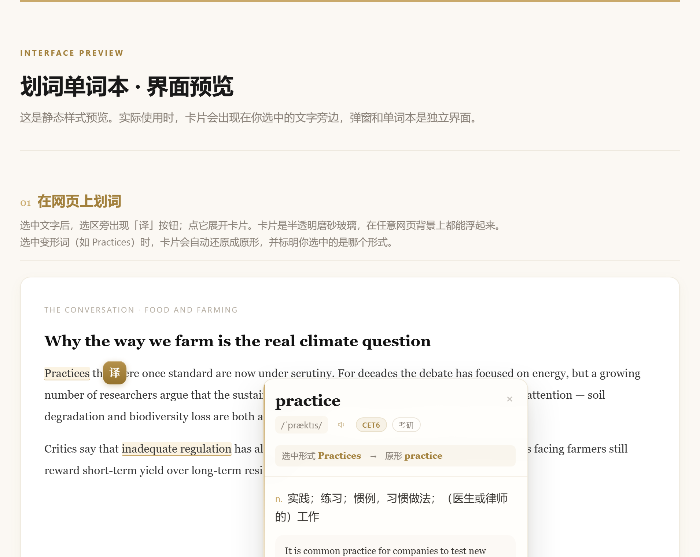
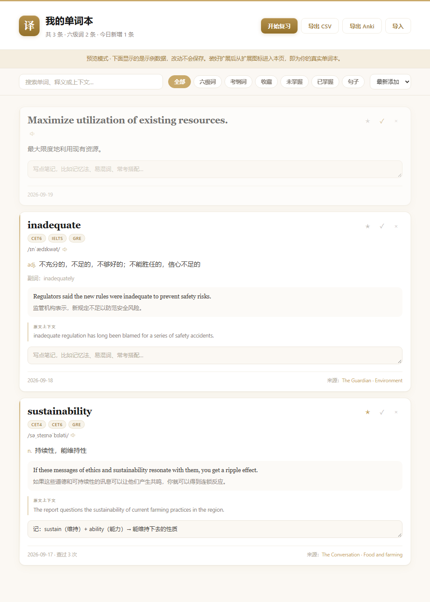
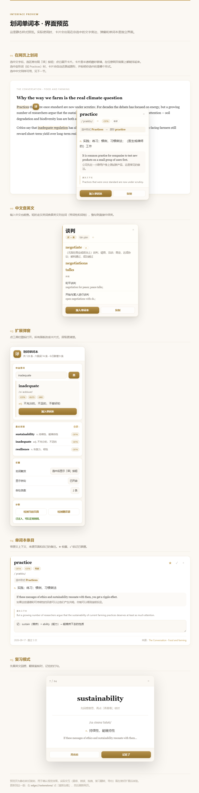
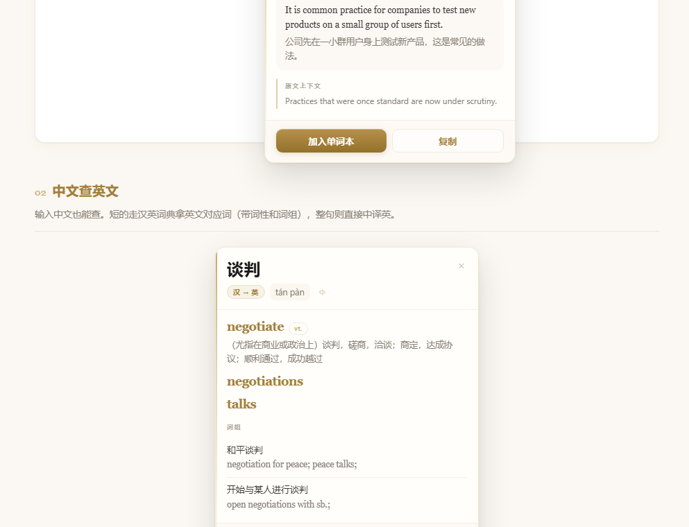

<div align="center">

# 划词单词本 · CET-6

**在任意网页上选中一个单词，即刻查词，一键存进单词本**


一个不联网上传数据、不需要注册账号的划词词典扩展。<br>
为备考六级做的，顺手做完了整个单词本闭环。

</div>



---

## 这是什么

备考六级的时候，读外刊遇到生词，流程总是很碎：划词 → 复制 → 切到词典网站 → 看释义 → 想记下来 → 再切到笔记软件……

这个扩展把这一串压成一步：**选中，点一下，存好**。

- 查词用的是有道词典的公开接口，数据里自带**考纲标签**（CET4 / CET6 / 考研 / GRE / IELTS…），一眼知道这个词值不值得背
- 存词时会自动抓取**你看到它的那句话**，以后复习能想起当时的语境
- 选到变形词会自动还原成**原形**（`Practices` → `practice`），背的是原形而不是一堆变形
- **双向查词**：选中英文查中文，选中中文查英文（`谈判` → `negotiate`）
- 数据全在浏览器本地，只有你主动选中的文字会发给翻译接口

---

## 功能

### 划词查词

选中网页上的单词或句子，旁边冒出小圆钮「译」，点开就是一张卡片：

音标 · 发音 · 考纲标签 · 中文释义 · 词形变化 · 双语例句 · **原文上下文**

**点卡片以外任何地方都会关掉它**（ESC 和右上角 × 也行）。

触发方式可调：`选中后显示按钮` / `选中即翻译` / `关闭划词`（只用右键菜单）。

### 变形词自动还原

```
选中形式 Practices  →  原形 practice
```

卡片会把标题换成原形，并在音标下方标出你选中的是哪个形式。
存进单词本时也存原形——先存 `surrendered` 再存 `surrender`，会合并成同一条。

### 中文查英文

选中中文同样能查：

```
谈判                      tán pàn   [汉 → 英]
negotiate  vt.            （尤指在商业或政治上）谈判，磋商，洽谈…
negotiations / talks
词组
和平谈判 → negotiation for peace; peace talks;
```

短词走汉英词典拿英文对应词（带词性和词组），整句直接中译英。
卡片上的发音按钮读的是对应的**英文词**。

### 单词本

搜索（变形词也能搜到）、按「六级词 / 考纲词 / 收藏 / 未掌握 / 句子」筛选、
写备注（自动保存）、★ 收藏、✓ 标记已掌握。

### 翻卡复习

先看英文回想，再翻答案核对，记住的打勾。

### 导出（6 种格式，都有排版）

| 格式 | 说明 |
|---|---|
| **Word** `.docx` | A4、页脚页码、金色表头速记表，可直接打印 |
| **Excel** `.xlsx` | 13 列，冻结首行 + 自动筛选 + 表头样式 |
| **网页** `.html` | 自包含单文件，浏览器里 Ctrl+P 存成 PDF |
| **Anki** `.txt` | 卡片字段内嵌样式，导入即好看 |
| **CSV** / **JSON** | 纯数据 / 完整备份 |

> Word 和 Excel 是**真正的 Office 文件**——扩展内置了自己写的 OOXML 生成器和 ZIP 打包，
> 不引任何第三方库，不是「HTML 改后缀」。

---

## 界面

<table>
<tr>
<td width="50%"></td>
<td width="50%"></td>
</tr>
<tr>
<td align="center">划词卡片（磨砂玻璃浮层）</td>
<td align="center">单词本管理页</td>
</tr>
</table>



中文查英文的卡片长这样：



**不想装扩展先看效果**：直接打开 [`docs/preview.html`](docs/preview.html)，是四个界面的静态复刻。

---

## 安装

### ⚠️ 先解压到纯英文路径

> 路径里**不能有中文或空格**，否则浏览器会报「清单文件缺失或不可读取」。
> 这是 Windows 上最常见的失败原因。

```bash
git clone https://github.com/Mikf-1126/cet6-wordbook.git D:/cet6-wordbook
```

或者下载 ZIP 解压到 `D:\cet6-wordbook` 这类位置。**不要**放在「桌面」「下载」「新建文件夹」下面。

### Edge

1. 地址栏输入 `edge://extensions/`
2. 打开 **左下角** 的「开发人员模式」（Edge 的开关在左侧栏最下面，不在右上角）
3. 点「加载解压缩的扩展」→ 选中 `cet6-wordbook` 文件夹

### Chrome

1. 地址栏输入 `chrome://extensions/`
2. 打开 **右上角** 的「开发者模式」
3. 点「加载已解压的扩展程序」→ 选中同一个文件夹

### 最后一步

**把已经打开的网页刷新一遍（F5）。** 装扩展之前就开着的页面不会生效。

装好后点扩展图标 → 「检测当前页面」和「检测翻译源」各点一次，两项都正常就可以用了。

详细排错见 [`docs/INSTALL.md`](docs/INSTALL.md)。

---

## 技术实现

几个自己觉得值得一提的地方：

### 1. 翻译接口的三级降级链

有道词典的接口会按 `Origin` 拦截请求——带 `chrome-extension://` 一律 **403**，
但它自己的域名放行。用 `declarativeNetRequest` 改写请求头绕过，
同时**准备三级降级**，任何一档挂了都还能用：

```
有道词典 jsonapi  →  音标 + 释义 + 考纲标签 + 例句 + 原型   （数据最全）
    ↓ 失败
有道翻译 aidemo   →  译文 + 发音音频                       （任何 Origin 都放行）
    ↓ 失败
MyMemory          →  纯译文                                （最后兜底）
```

卡片上会显示当前命中的是哪一档，方便定位问题。

### 2. 词形还原靠一个没文档的字段

有道返回的 `ec.word[0].prototype` 才是原型（`return-phrase` 只会原样回显查询词）。
但它偶尔会判错同形词——`went` → `wend`、`better` → `well`——
所以配了一张 60 多条的不规则变形校正表，只在该词确实被判为变形时才覆盖。

### 3. 从零实现 OOXML 导出

不引库、不联网，纯 JS 写 OOXML + ZIP 打包（store 模式，省掉 deflate）：

- `.docx`：8 个部件，含命名样式、A4 页面、页脚 PAGE 域、跨页重复表头
- `.xlsx`：8 个部件，含冻结窗格、自动筛选、列宽、自定义 cellXfs

踩过的坑（单位是 twip、`w:sz` 是半磅、XLSX 的 `fills[0]` 必须 `none`、
`fills[1]` 必须 `gray125`…）都写在 [`dev/README.md`](dev/README.md) 里了。

### 4. 浮层用 Shadow DOM 完全隔离

注入到任意网页的 UI 全部封装在 Shadow DOM 里，宿主页面 CSS 改不乱它，
它也不会污染宿主页面。

---

## 目录结构

```
cet6-wordbook/            ← 仓库根目录 = 扩展本体，clone 下来直接能加载
├── manifest.json         扩展清单
├── background.js         后台：翻译请求（三级降级）+ 单词本读写 + 右键菜单
├── content.js            页面脚本：划词检测、浮动卡片、存词
├── exporters.js          导出生成器（docx / xlsx / html / anki / csv）
├── popup.html/.css/.js   工具栏弹窗
├── notebook.html/.css/.js 单词本管理页
├── rules.json            declarativeNetRequest 请求头改写规则
├── icons/
├── docs/
│   ├── INSTALL.md        详细安装与排错
│   ├── preview.html      界面静态预览（双击即看）
│   └── screenshots/
└── dev/                  开发工具，不参与运行
    ├── selftest.js       后台逻辑自测
    ├── export_test.js    导出文件生成测试
    └── make_icons.py     图标生成
```

---

## 常见问题

| 现象 | 原因 | 解决 |
|---|---|---|
| **清单文件缺失或不可读取** | 路径含中文，或选错文件夹层级 | 解压到纯英文路径；选中的那层要能直接看到 `manifest.json` |
| 找不到「开发人员模式」 | 用的是 Edge | 开关在 `edge://extensions/` **左下角** |
| **选中文字没反应** | 页面在装扩展之前就打开了 | 按 **F5 刷新页面**（最常见原因） |
| 同上 | 是 PDF 文件 | 内置 PDF 阅读器不允许注入。用扩展弹窗里的「快速查词」粘贴查询 |
| 同上 | 是 `edge://` / `chrome://` 内置页 | 浏览器不允许任何扩展注入 |
| 翻译不出来 | 接口临时限流 | 点「检测翻译源」看是哪一档，隔天再试 |

**排错第一招**：点扩展图标 → 「**检测当前页面**」，它会直接告诉你原因。

---

## 已知限制

- **PDF 文件**、浏览器内置页无法划词 → 用「快速查词」兜底
- 免费翻译接口有每日调用上限（正常背单词的用量远够）
- 有道词典接口可能变动；若「检测翻译源」从完整档掉到基础档，说明接口路径变了

---

## 开发

无构建步骤，改完直接在扩展管理页点「重新加载」即可。

自测（在 Node 里用 mock 的 `chrome` 环境跑真实的 `background.js`，不需要装进浏览器）：

```bash
cd dev
node selftest.js        # 翻译链路 / 存词去重 / 导出
node export_test.js     # 生成真实的 .docx / .xlsx 到磁盘
```

生成图标（需要 PIL + 微软雅黑字体）：

```bash
python dev/make_icons.py
```

详细开发笔记见 [`dev/README.md`](dev/README.md)。

---

## 更新日志

见 [CHANGELOG.md](CHANGELOG.md)。

---

## 许可

[MIT](LICENSE)

> 本项目使用的翻译接口均为第三方公开接口，仅供个人学习使用，请勿用于商业用途。
> 词典数据版权归有道词典所有。
